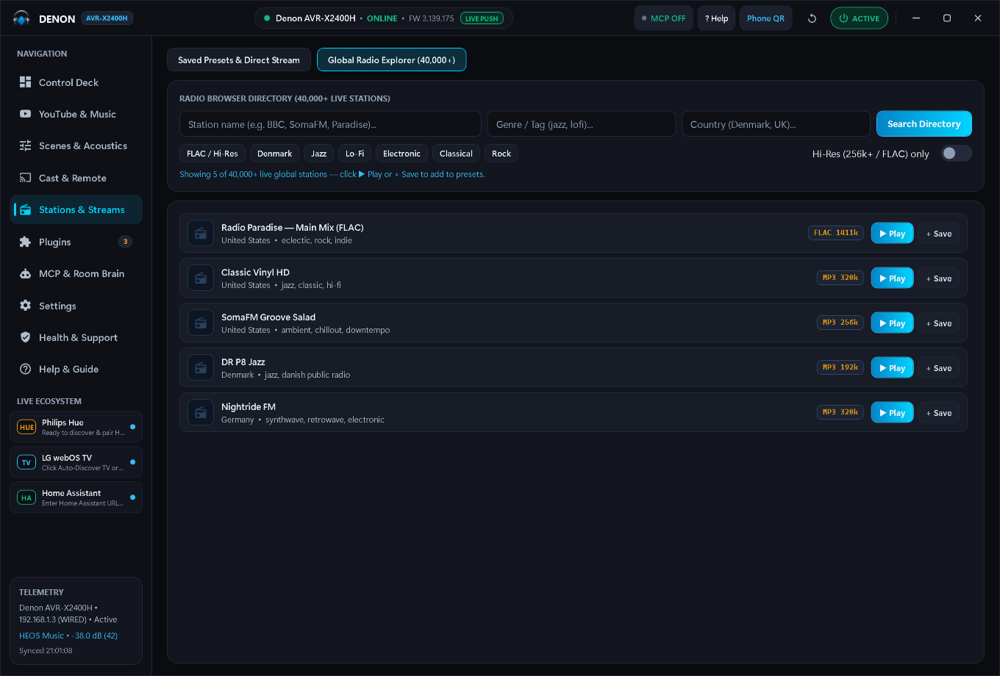
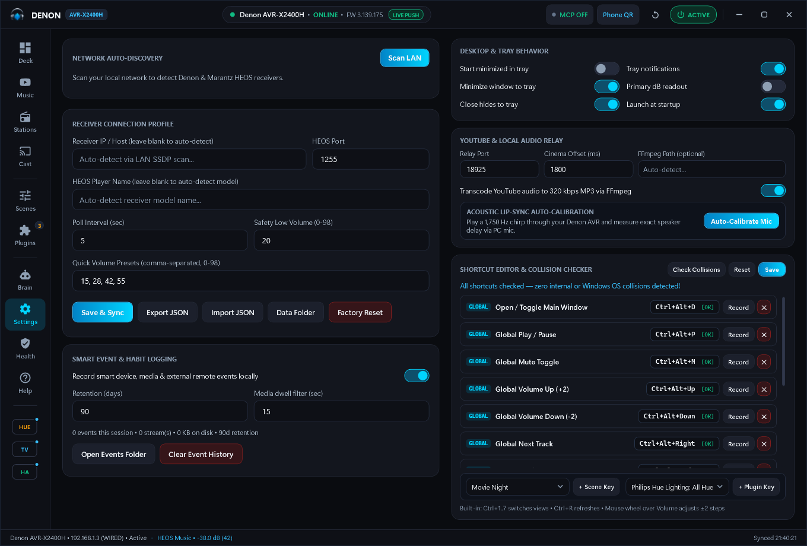

# Denon Desktop — Precision Hi-Fi Controller & LAN Audio Hub

<p align="center">
  <strong>Flagship Windows 10/11 desktop controller, YouTube/PC audio stream bridge, Smart Scenes engine, and Couch Phone Remote for HEOS-enabled Denon &amp; Marantz AV Receivers.</strong>
</p>

<p align="center">
  
  
  
  
</p>

---

## Screenshots

### Control Deck & Retro Analog Hi-Fi VU Meters
Real-time zero-lag HEOS push sync (`<50 ms`), auto-detected receiver model badge, dual illuminated L/R Analog VU Meters, clickable dB / 0–98 OLED master volume, and one-click Scenes & Stations.


### YouTube & YouTube Music Deck + LAN Stream Bridge
Search YouTube Music, Videos, or Playlists (or paste any YouTube / YouTube Music URL), stream directly to your Denon over LAN via the built-in zero-admin 320 kbps MP3 / M4A relay, manage an auto-advancing Up-Next queue, and launch the floating **WebView2 Cinema Companion** with A/V sync nudges.


### Smart Scenes & Live Acoustic Tuning Console
One-click AVR macros (`Movie Night`, `Late Night`, `Pure Hi-Fi`, `Morning Jazz`, `Party Multi-Ch`, plus **Capture Live AVR** & inline Scene Editor) with smooth volume ramping, paired with live Telnet `:23` controls for Audyssey MultEQ, Dynamic EQ, Dynamic Volume, Audio Restorer, Front Panel Dimmer, Subwoofer/Dialog trims, and Tone Control.


### Couch Phone Remote (QR Code), Cast PC Audio & Local Hi-Res FLAC Jukebox
Scan the QR code from any phone on your Wi-Fi for a mobile Remote & Party Jukebox (zero app install), cast live Windows system audio via WASAPI loopback (`MP3 320 kbps` or `Lossless WAV`), or drag-and-drop `.flac` / `.wav` / `.mp3` folders for bit-perfect LAN streaming.


### Global Radio Explorer (40,000+ Live Stations)
Browse and filter 40,000+ worldwide internet radio stations by name, genre, country, or **FLAC / 256k+ Hi-Res** via the open Radio Browser directory, play in one click, and save directly to your presets.



### Settings, Auto-Discovery & Shortcut Collision Checker
Auto-detect receiver IP & model name, configure LAN relay / FFmpeg / Cinema A/V sync offset, and customize global Windows hotkeys & in-app shortcuts with real-time internal and Win32 OS collision detection.



---

## Key Features

- **Extensible Plugin System & Official SDK (`Denon.App.PluginSdk` 1.15)**: Host built-in plugins and drop-in external `.NET 10` plugin `.dll` assemblies (`%LocalAppData%\DenonDesktop\plugins\external\`) via isolated `AssemblyLoadContext`, complete with per-plugin JSON storage, AVR event broadcasting, callable actions, and a 60 Hz zero-allocation FFT Audio-Reactive & Album-Art Palette API. **SDK 1.15** adds a **Receiver Control API** (`IPluginReceiverControl`: power, input, sound mode, volume, mute, Smart Scenes), granted only to plugins that declare `PluginCapabilities.ReceiverControl` and logged per plugin.
- **Chromecast & Google Cast Plugin (external, separate download)**: The first standalone drop-in plugin. Finds Cast devices by mDNS, shows live now-playing, controls media and volume over Cast v2, and drives the Denon when an app starts or stops (power on, Smart Scene, input, sound mode, idle power-off). It logs *what* you cast (app, title, watched time) to the habit event log. See [`external-plugins/Denon.Plugin.Chromecast`](external-plugins/Denon.Plugin.Chromecast/README.md).
- **Habit-Ready Event Telemetry**: Structured NDJSON event logs per domain (`media`, `avr`, `tv`, `lighting`, `control`) in `%LocalAppData%\DenonDesktop\logs\events\`. Watch and listen sessions (`session.started` / `session.ended`) from the AVR, the LG TV and plugins share one schema. Parallel sessions of one viewing (Cast → TV HDMI → Denon TV Audio) are marked with `coveredSec` / `exclusiveSec` / `coveredBy`, so summing `exclusiveSec` gives real time with no double counting.
- **Built-In MCP Server (`http://127.0.0.1:18926/mcp`)**: Spec-compliant Streamable HTTP MCP server with Bearer auth, Room Graph resources, habit summaries, event queries, and auto-bridged plugin actions. Copy the client config from **MCP & Room Brain** into Claude Desktop, Cursor, VS Code or other MCP clients.
- **3 Official Built-In Plugins**:
  - **Philips Hue Smart Lighting & 50 Hz Entertainment DTLS Sync** (`Denon.Plugin.PhilipsHue`): Auto-discovers Bridges (Cloud + offline LAN SSDP), guided 30-second Link-Button HTTPS pairing with Entertainment `clientkey`, Rooms/Zones/Lights/Scenes, **4-Mode Real-Time FFT Music Sync** (*Bass Pulse*, *Spectrum Split*, *Album-Art Ambient*, *Cinema Subtle*) over **50 Hz Hue Entertainment API v2 DTLS/UDP (`:2100`)** with automatic LAN REST fallback, and Denon AVR automations.
  - **Smart TV Control — LG webOS + Wake-on-LAN** (`Denon.Plugin.SmartTv`): SSAP WebSocket (`:3000`) pairing, Wake-on-LAN Power On, Power Off, HDMI 1/2/3 & app launching, TV mute, and on-screen toast alerts when Smart Scenes fire.
  - **Home Assistant REST & Webhook Bridge** (`Denon.Plugin.HomeAssistant`): Trigger Home Assistant scenes/scripts/switches/blinds from Denon Desktop or the Couch Phone Remote and push real-time `sensor.denon_desktop_receiver` telemetry & webhooks.
- **Smart Scenes 2.0 & Automation Rules Engine**: Chain ordered plugin actions with millisecond delays directly onto Smart Scenes, trigger macros automatically on **App Launch** (`vlc`, `Plex`, games) or **Time-of-Day / Night Guard** schedules, and bind **Global Windows Hotkeys** to any Smart Scene or Plugin Action with 4-layer collision checking.
- **Studio Metering, 31-Band RTA Spectrum Analyzer, Synced Lyrics & Acoustic Auto-Calibration**: Switch effortlessly between dual-channel VSync **Analog Hi-Fi VU Meters**, a **31-Band Real-Time OLED FFT Spectrum Analyzer (`25 Hz–16 kHz`)**, or **Both**, view live time-synced lyrics via **LRCLIB**, and measure exact HEOS buffer delay in 1 click using the **1,750 Hz PC Mic Chirp Auto-Calibrator**.
- **Zero-Config Auto-Discovery & Model Detection**: Automatically discovers Denon & Marantz HEOS receivers on your local network via SSDP + HEOS `:1255`, detects the exact hardware model (`AVR-X2400H`, `AVR-X3800H`, `CINEMA 50`, etc.) and firmware version, and dynamically updates the UI branding (`DENON` / `MARANTZ`) and title bar.
- **Zero-Lag Real-Time Push Events (`LIVE PUSH`)**: Subscribes to `heos://system/register_for_change_events?enable=on` on a dedicated listener socket so physical volume knob turns, remote mutes, and playback changes update the OLED dial in `<50 ms`.
- **Retro Dual-Channel Analog VU Meters**: Illuminated obsidian/amber/cyan stereo VU meters right on the Hero OLED deck — driven by real live WASAPI RMS levels during PC Audio Cast and smooth volume-scaled ballistics during HEOS playback.
- **YouTube & YouTube Music Cast + Cinema Companion**: Search music/videos/playlists or paste any URL, transcode on the fly to 320 kbps MP3 (via `ffmpeg`, auto-detected) or proxy M4A directly over LAN to HEOS, auto-advance queues, and optionally watch muted video in a floating **Pin-on-Top** WebView2 Cinema window with `±100ms` / `±500ms` A/V sync nudges.
- **Couch Phone Remote & Party Jukebox**: Mobile-friendly web app served on port `18925` with an in-app QR code — control Power, Volume, Mute, Inputs, Scenes, Radio Stations, and shared YouTube Music queue from any phone on your Wi-Fi.
- **Cast Any PC Audio (WASAPI Loopback)**: Wirelessly stream Windows audio from your default output or any specific playback device to your Denon AVR in **MP3 320 kbps** or **Lossless WAV** with silence keepalive so HEOS never drops between tracks.
- **Drag-and-Drop Local Hi-Res FLAC Jukebox**: Drop `.flac`, `.wav`, `.mp3`, `.m4a`, `.aac`, `.ogg`, or `.opus` files/folders directly onto the app for bit-perfect HTTP Range streaming over LAN.
- **Smart Scenes & Deep Audyssey / Acoustic Tuning**: Customize multi-step hardware macros with smooth volume ramping, snapshot your current AVR state in 1 click, and tune Audyssey MultEQ, Dynamic EQ, Dynamic Volume, Audio Restorer, Front Panel Dimmer (`Bright`/`Dim`/`Dark`/`Off`), Subwoofer & Dialog trims (`-12..+12 dB`), and Bass/Treble.
- **System Tray Companion & Shortcuts**: Single-click floating taskbar mini-flyout, dark-themed tray menu with Quick Scenes & Stations, single-instance guard, optional launch at Windows startup, and keyboard shortcuts (`Space`, `M`, `Ctrl+↑/↓`, `F5`, `Ctrl+1..7`).

---

## Denon & Marantz Model Compatibility

Denon Desktop combines the **HEOS CLI Protocol (TCP `:1255`)** for streaming, metadata, real-time push events, and discovery with the **Denon/Marantz AVR Control Protocol (Telnet TCP `:23`)** for power, exact dB volume, inputs, sound modes, Audyssey, dimmer, and trims.

| Hardware Family | Representative Models | HEOS Streaming, YouTube, PC Cast & Push (`:1255`) | Full AVR Control, Scenes & Acoustics (`:23`) | Notes |
| :--- | :--- | :---: | :---: | :--- |
| **Denon X-Series AVRs (HEOS Built-In, 2017–Present)** | `AVR-X1400H`–`X1800H`, `X2400H`–`X2800H`, `X3400H`–`X3800H`, `X4400H`–`X4800H`, `X6400H`–`X6800H`, `X8500H`, `AVC-A1H`, `A10H` | **Full** | **Full** | Verified live on **`Denon AVR-X2400H`**; all model names & firmware auto-detected |
| **Denon S-Series AVRs (HEOS Built-In)** | `AVR-S650H`–`S670H`, `S750H`–`S770H`, `S950H`–`S970H` | **Full** | **Full** | Zone 2 / specific Audyssey tiers depend on AVR hardware |
| **Denon Stereo & Network Receivers (HEOS)** | `DRA-800H`, `DRA-900H`, `PMA-900HNE`, `CEOL N10`–`N12` | **Full** | **Partial** | Power, Volume, Mute & Inputs work; surround/Audyssey controls skipped gracefully |
| **Marantz HEOS AVRs & Cinema Series** | `NR1509`–`NR1711`, `SR5012`–`SR8015`, `CINEMA 70s / 60 / 50 / 40 / 30`, `AV 10`, `MODEL 40n` | **Full** | **Full** | UI automatically switches branding badge to **`MARANTZ`** upon detection |
| **Denon Home / HEOS Speakers & Soundbars** | `Denon Home 150 / 250 / 350 / 550`, `HEOS 1 / 3 / 5 / 7 / Amp / Link` | **Full** | **N/A** | HEOS streaming, YouTube/PC Cast, Queue & Phone Remote work; no AVR `:23` port |
| **Legacy Non-HEOS Denon/Marantz AVRs (2012–2016)** | `AVR-X1000`–`X4200W`, `SR5008`–`SR7010` | **Not Supported** | **Partial** | Requires HEOS Built-In for discovery, streaming & push events |

> **Recommended Receiver Setting:** On your Denon/Marantz receiver, enable **`Setup → Network → Network Control → Always On`** so Denon Desktop can wake your receiver from Standby and discover it reliably at any time.
>
> **Note on AVR Telnet (`:23`):** Denon/Marantz receivers accept only one concurrent Telnet `:23` connection at a time. Close other Telnet-based remote apps if AVR commands time out, or click **Reset Links** in Health & Support.

---

## Getting Started

### Prerequisites
- **Windows 10 or Windows 11 (x64)**
- **Optional (Recommended for YouTube MP3 320k & PC Audio Cast):** [`ffmpeg`](https://ffmpeg.org/) installed on `PATH` (e.g. `winget install Gyan.FFmpeg`). Denon Desktop auto-detects WinGet and `PATH` installs, and falls back to Direct M4A / Lossless WAV if FFmpeg is not present.
- **Optional (Cinema Companion Video Window):** Microsoft Edge WebView2 Runtime (pre-installed on Windows 11 and most Windows 10 systems).

### Download Prebuilt Installer or Portable EXE (GitHub Releases)
Download from the [**Releases**](../../releases/latest) page (no .NET runtime installation required):
- **Windows Installer (Unsigned):** **`DenonDesktop-Setup-win-x64.exe`** — installs cleanly per-user with Start Menu & optional Desktop/Startup shortcuts and Add/Remove Programs uninstaller. *(Because this open-source build is unsigned, Windows SmartScreen may show a prompt — click **More info → Run anyway**.)*
- **Portable Single-File Executable:** **`Denon.App.Desktop-win-x64.exe`** — run directly from any folder with zero installation.
- **Chromecast plugin (optional, own release):** download **`Denon.Plugin.Chromecast-<version>.zip`** from the latest [`chromecast-v*` release](../../releases?q=chromecast&expanded=true), unzip it to `%LocalAppData%\DenonDesktop\plugins\external\Chromecast\`, and restart Denon Desktop. Needs Denon Desktop 1.15 or later.

1. Launch Denon Desktop — on first launch, it automatically scans your LAN and connects to your Denon/Marantz receiver.
2. To use **YouTube Cast**, **PC Audio Cast**, **Local FLAC Jukebox**, or the **Couch Phone Remote**, click **Allow Firewall** in the **YouTube & Music** or **Cast & Remote** tab once to open Private-LAN TCP port `18925`.

### Build From Source (.NET 10 SDK)

```powershell
# Build entire solution
dotnet build .\DenonDesktop.slnx

# Run the xUnit test suite
dotnet test .\DenonDesktop.slnx -c Release

# Run from source (opens window immediately)
dotnet run --project .\Denon.App.Desktop\Denon.App.Desktop.csproj -- --show

# Local release build, same steps as CI: tests -> single-file exe -> Inno Setup installer -> SHA256SUMS
# (needs Inno Setup 6: winget install JRSoftware.InnoSetup). Output: .\release-out\
pwsh -File .\build-release.ps1

# Build and install the external Chromecast plugin from source
pwsh -File .\external-plugins\Denon.Plugin.Chromecast\install.ps1
```

### Releases
- Push a `vX.Y.Z` tag to build and publish the app (installer, portable exe, checksums). Release notes come from the matching `CHANGELOG.md` section.
- Push a `chromecast-vX.Y.Z` tag to build and publish the Chromecast plugin as its own release (zip + checksum).

---

## Architecture

| Project | Responsibility |
| :--- | :--- |
| **`Denon.App.PluginSdk`** | Zero-dependency `.NET 10` Plugin SDK (`IDenonPlugin`, `IPluginViewProvider`, `IAudioReactivePlugin`, `IPluginContext`, `PluginAudioFrame`, `PluginAlbumArtPalette`, `PluginReceiverEvent`) for both built-in and drop-in third-party extensions. |
| **`Denon.App.Core`** | Persistent HEOS CLI (`:1255`) & AVR Telnet (`:23`) clients, real-time HEOS push listener, SSDP LAN auto-discovery, unified zero-admin LAN HTTP server (`LocalAudioRelayServer`), `YoutubeExplode` search/queue engine, Radio Browser 40k client, Smart Scenes 2.0 & `AutomationEngineService`, `PluginHostService` (`AssemblyLoadContext` loader), and atomic JSON settings store. |
| **`Denon.Plugin.PhilipsHue`** | Official Philips Hue plugin (compiled strictly against `Denon.App.PluginSdk`): Bridge discovery & pairing, CLIP v1/v2 Rooms/Lights/Scenes/Entertainment Area client, **50 Hz DTLS/UDP (`:2100`) Entertainment streaming**, 4-Mode Real-Time FFT Music Sync, Album-Art Ambient sync, Demo Simulator, and Obsidian WPF dashboard. |
| **`Denon.Plugin.SmartTv`** | Official LG webOS Smart TV + Wake-on-LAN plugin: SSAP WebSocket (`:3000`) pairing, power, HDMI input & app switching, on-screen toast notifications, and AVR scene coordination. |
| **`Denon.Plugin.HomeAssistant`** | Official Home Assistant REST & Webhook plugin: trigger HA scenes/scripts/switches and publish live `sensor.denon_desktop_receiver` telemetry. |
| **`external-plugins/Denon.Plugin.Chromecast`** | Standalone external Chromecast / Google Cast plugin (not in the solution, released separately): Cast v2 over TLS `:8009`, mDNS discovery, habit watch sessions, per-device Denon automations. Uses the SDK compile-only. |
| **`Denon.App.Core.Tests`** | xUnit tests for core services and review regressions, including event telemetry and session overlap. |
| **`Denon.App.Desktop`** | Custom-chromed Obsidian Hi-Fi WPF UI, dual-channel VSync `AnalogVuMeterControl` + 31-band `SpectrumAnalyzerControl`, 512-point Radix-2 FFT `LiveAudioAnalyzerService`, `AlbumArtPaletteService`, 1-click `AcousticSyncCalibrationService`, `NAudio` WASAPI loopback PC audio caster, `QRCoder` Phone Remote QR generator, `WebView2` Cinema Companion window, Win32 Global Hotkey engine, and Windows startup integration. |

### Local Data & Persistence
- **Settings:** `%LocalAppData%\DenonDesktop\settings.json` (JSON export/import supported in Settings)
- **Logs:** `%LocalAppData%\DenonDesktop\logs\app.log`
- **Event telemetry (habits):** `%LocalAppData%\DenonDesktop\logs\events\<stream>-<date>.jsonl`, plus `room-habits.json`
- **External plugins:** `%LocalAppData%\DenonDesktop\plugins\external\` (one folder per plugin; per-plugin data in `plugins\data\`)
- **WebView2 Cache:** `%LocalAppData%\DenonDesktop\webview2\`

### Keyboard Shortcuts (Customizable in Settings)
All global Windows hotkeys and in-app shortcuts can be recorded, cleared, and checked for internal & OS collisions in **Settings → Shortcut Editor**:

| Default Shortcut | Scope | Action |
| :--- | :---: | :--- |
| `Ctrl + Alt + D` | Global | Open / Toggle Main Window (even from tray) |
| `Ctrl + Alt + P` | Global | Play / Pause Playback |
| `Ctrl + Alt + M` | Global | Toggle Receiver Mute |
| `Ctrl + Alt + ↑` / `↓` | Global | Adjust Master Volume ±2 steps |
| `Ctrl + Alt + →` / `←` | Global | Next / Previous Track |
| `Space` | In-App | Play / Pause Playback |
| `M` | In-App | Toggle Receiver Mute |
| `Ctrl + ↑` / `Ctrl + ↓` | In-App | Adjust Master Volume ±2 steps |
| `F5` / `Ctrl + R` | In-App | Force Refresh Receiver Telemetry |
| `Ctrl + 1..7` | In-App | Switch Navigation Views |
| **Mouse Wheel** (over Volume card) | In-App | Adjust Master Volume ±2 steps |

---

## Changelog & License

- See [CHANGELOG.md](CHANGELOG.md) for release history.
- MIT License — see [LICENSE](LICENSE) for details.
